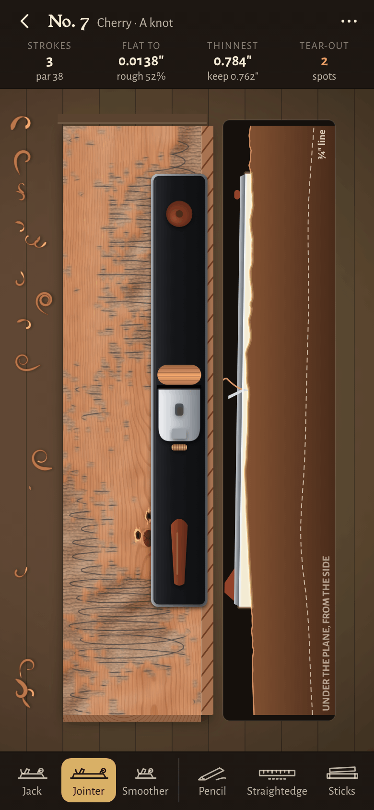
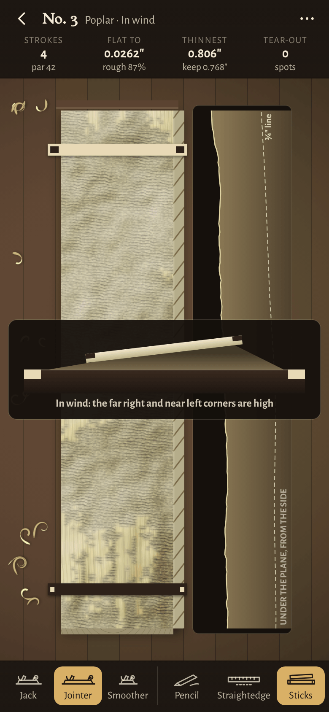
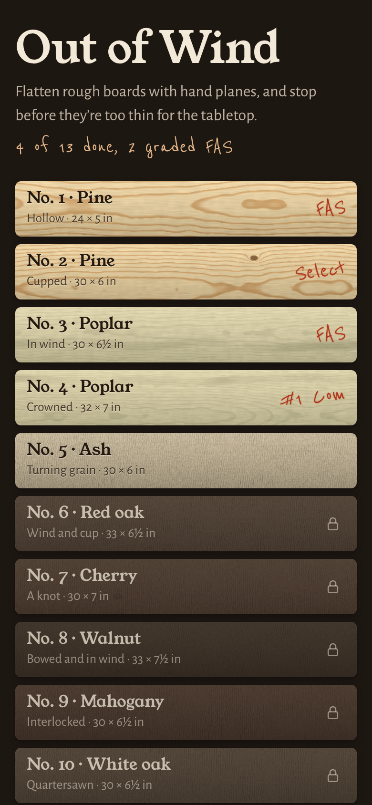

# Out of Wind

**Play it: [out-of-wind.junkdrawer.works](https://out-of-wind.junkdrawer.works/)**

**Flatten rough boards with hand planes.** Each board comes off the sawmill bowed, cupped or twisted, sometimes with grain that turns around partway along, and has to finish flat at three-quarters of an inch for a tabletop. Swipe along it to take a stroke: the plane rides on the high spots and cuts only there. Scribble pencil across the face and plane until it's gone, check it with a straightedge and winding sticks, and stop before you go through the gauge line.

<p align="center">
  
  &nbsp;
  
  &nbsp;
  
</p>

## How it plays

- **Swipe along the board to take a stroke.** The blade cuts under your finger, pushing away or pulling toward you; dragging back lifts the iron. A finger can't start exactly at the end of the board, so a stroke put down within a fingertip of the end it's leaving starts from that end, and one lifted that close to the other end runs off it; one put down well onto the board starts where it's put down, and the bench says so if that leaves a high rough end. A stroke counts when it takes a shaving; one that cuts nothing is free, and the bench says why: it rode on higher wood, it went across the board, or it was off the board altogether. The first time on the bench, a faint plane glides from just off one end to just off the other until you take a stroke.
- **Three planes.** The 22-inch jointer rides over hollows and takes the high spots down until the face is true. The 14-inch jack has a curved edge set deep: it scoops high spots off fast and leaves a scalloped face. The 9-inch smoother is set fine; it follows the face rather than flattening it, and gets through wild grain clean.
- **The plane rests on what's under its sole.** Along the stroke the sole sits on the highest points beneath it, so the long jointer bridges a hollow and the short smoother dips into one. Across the board it's held square to the face, and it can't cut deeper than the wood either side of its blade, so you work across the board lane by lane. Pressure goes on the toe as the plane comes onto the board and on the heel as it leaves, so it doesn't dive off the ends.
- **Pencil.** Scribble across the face, then plane: the pencil goes first from the high spots, and where it's left, the plane didn't reach. A clean face only says the plane cut everywhere, which it will on a crowned or twisted face too.
- **Straightedge.** Drag along or across the board to lay it down. The side view shows light under it wherever the face dips away, and a note says what it sees: light in the middle (a hollow along the board, a cup across it), rocking on a high spot and where, the face falling away toward one end, or two high spots.
- **Winding sticks.** Two sticks across the ends, and the view sighting down the board between them, the far stick pale with dark inlays and the near one dark with pale ones: out of wind, their top edges are parallel; twisted, the far one tilts (exaggerated a great deal).
- **The side view** under the board (beside it on a phone) shows the face along the line you're working, magnified, with the plane resting on its high spots, light under the sole wherever it bridges a hollow, and the dashed gauge line three-quarters of an inch up from the underside.
- **The lamp** rakes across the face from the far end, so slopes show as light and shade: the steps between lanes you've planed and, once the saw marks are off, a cup as one long edge a little darker than the other. It's a hint, not a measurement; the straightedge and the sticks are those.
- **The top bar** shows the four marks a board is graded on as you go: strokes against par, how far the face is from flat and what flat is (or how much is still rough-sawn), the thinnest spot against the thickness to keep, and spots of tear-out. Each turns amber once its mark is gone. How flat reads a place finer than the other figures (0.0065″ against an aim of 0.0059″), rounded up until the face is flat, so the last few thou show. While the plane is down, a note fades out of the way of the board's far end.
- **Read the grain.** The strip along the face is the board's edge, and the lines in it are the fibres running out to the face: follow one from the face into the wood and it heads the way to plane, whichever way the bench is turned (on a phone held upright the board stands up the screen, and the How-to draws it that way). Go the other way and the grain tears out with a crackle, leaving a torn pit you'll have to plane out; the first one says which way the grain runs there. Curly maple turns every inch and interlocked mahogany turns in stripes, so on those only the smoother gets through clean. Going back to plane out tear-out rings each spot for a moment.
- **Twist and crowns.** Long straight strokes take an even shaving off a twisted face or a crown without changing its shape, so those need short strokes on the high spots, or a stroke from one high corner diagonally to the other. The early boards say what just happened as you go, and if eight strokes haven't brought a face any nearer flat, the bench says what shape is left (hollow, crowned, cupped, in wind, or high patches), what takes it out and where the face stands highest, on every attempt.
- **The last few thou.** Planed all over and nearly flat (within 0.21 mm), every stroke says where the face stands highest, toward which end and by which edge, and to take a stroke there with the smoother, so the end of a board is a decision rather than a hunt.
- **Thirteen boards:** pine, poplar, ash, red oak, cherry, walnut, mahogany, quartersawn white oak, hard maple and curly maple, each warped its own way, then a panel glued up from walnut, maple and cherry with the middle board turned end for end and standing proud. Each opens when you finish the one before; tap a locked one and it says which to finish first. A board you've finished opens fresh, with your best grade on its card, to plane again, and the rack offers "Back to" whichever board part-way through you planed last. Back (Android's gesture too) goes from a board to the rack, and from the rack out of the game.
- **The tabletop.** Finishing the panel goes on to the tabletop itself: the panel drawn planed and oiled on a walnut base, with every board's grade pencilled in a tally under it, how many were FAS and the strokes they took against par. Once every board is done, the rack keeps a button for it.
- **A board is done when it's flat and planed all over.** Then it gets a mark each for keeping its thickness, no tear-out and strokes within par, and a lumber grade: FAS for all of them, then Select, No. 1 Common and No. 2 Common, pencilled on the rack as a lumberyard marks them (FAS, Select, #1 Com, #2 Com). Go through the gauge line anywhere and the board's a cull.
- **Par, and the thickness each board starts at, come from a solver** that planes every board the way a careful woodworker would: it works out the plane that leaves the board thickest, never planes past it, goes with the grain, and gets below any tear-out at the end. Every board starts thick enough for the solver to finish it a little above the line. Par is the solver's strokes and half as many again, because the solver measures exactly where the board stands high and a person finds out with the pencil and the checks, or what following the board's card takes, whichever is more (the panel's, 129). The thickness mark asks for at least halfway between the gauge line and what the solver kept, and the card before each board says how thick that is.
- **Every card works.** A second player (`scripts/cards.mjs`) planes each board the way its card says, judging the face only by what the page shows: the winding sticks, the light under the straightedge, rough patches, the grain on the edge, tear-out and the bench's notes, planing where they say the face stands highest. It has to finish every board, the panel too, within par, with its lanes spaced three different ways, and par is never less than it takes. It plays each board once more with every stroke put down 8 mm onto the board and lifted 8 mm short of the far end, as a finger does, and that has to finish as well.
- No account and no server. Your grades and any board you're part-way through stay in your browser. It works offline and installs to a phone's home screen. Inches in the US, millimetres elsewhere; switch in the menu. On a keyboard, 1, 2 and 3 pick the planes, and P, E and W the pencil, straightedge and winding sticks.

## Running it

It's a static site: plain HTML, CSS and JavaScript modules, with no build step.

```sh
npm start                     # serves it at http://localhost:8080 (any static file server will do)
npm test                      # the planes, boards, solver and cards in Node, then plays it in Chromium (needs Playwright)
npm run par                   # works out each board's rough thickness and par; add -- --write to save them
node scripts/cards.mjs        # plays each board the way its card says, and prints the strokes it took
node tools/screenshots.mjs    # redraws docs/phone-*.png and og.png (npm install first, for upng-js)
node tools/make-icons.mjs     # redraws the PNG icons from icon.svg
```

To put it online with GitHub Pages: **Settings → Pages → Build and deployment → Deploy from a branch**, then pick `main` and `/ (root)`. The `CNAME` file gives it its own address, out-of-wind.junkdrawer.works.

### Files

- `js/board.js`: a board as a grid of heights over a warped underside, with its warp, grain, knots and figure made from a seed; the measurements (flatness, the thinnest spot, the shape that's left, the straightedge and what it shows, the winding sticks); and saving one part-way.
- `js/plane.js`: the three planes and what a stroke does: where the sole rests, where the blade cuts, tear-out, and how near an end counts as off it.
- `js/boards.js`: the thirteen boards, with each one's rough thickness, par and thickness mark.
- `js/woods.js`: each wood's colour, grain and how readily it tears out.
- `js/solver.js`: the bot that planes each board to set par; `scripts/par.mjs` runs it.
- `scripts/cards.mjs`: a person following each board's card, who sees only what the page shows; the tests and `scripts/par.mjs` use it.
- `js/wood.js`: draws each board's planed and rough-sawn faces, pixel by pixel.
- `js/draw.js`: draws the bench: the board's layers, the lamp, pencil, tear-out, the plane, shavings, the checks and the side view.
- `js/table.js`: draws the finished tabletop for the end.
- `js/app.js`: the page: the rack of boards, the bench, strokes from your finger, grading and saving.
- `js/sound.js`: shavings, tear-out, pencil, the steel rule, the winding sticks and the bell, all made with Web Audio.
- `js/units.js`, `js/store.js`, `js/rng.js`: inches or millimetres, what's kept in localStorage, and seeded randomness.
- `fonts/`: Young Serif, Alegreya Sans and Reenie Beanie (SIL Open Font License), served from here so nothing loads from elsewhere.
- `sw.js`: keeps a copy for playing offline.
- `test/unit.test.mjs`: the planes, the measurements, the boards and the solver, in Node; `test/e2e.mjs` plays the real page in Chromium on a phone, a laptop and a phone on its side.
- `icon.svg`, `tools/icon-full-bleed.svg` and `tools/make-icons.mjs`: the icon, and the script that draws the PNG icons from it.
- `og.png`, `docs/` and `tools/screenshots.mjs`: the link preview, the screenshots above, and the script that takes them.
